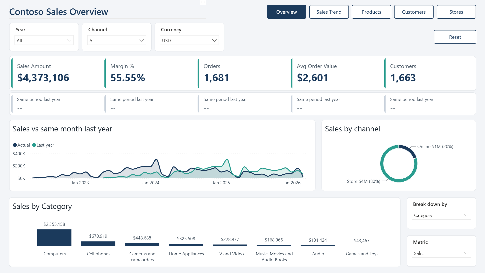
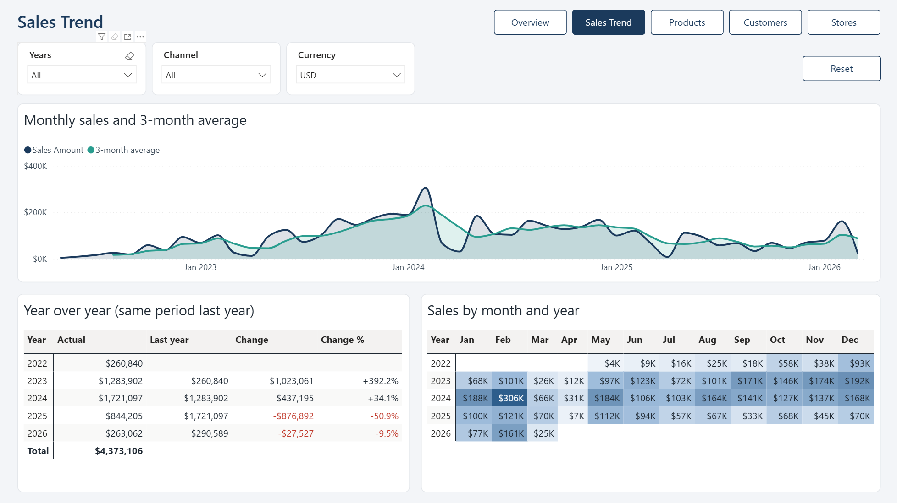
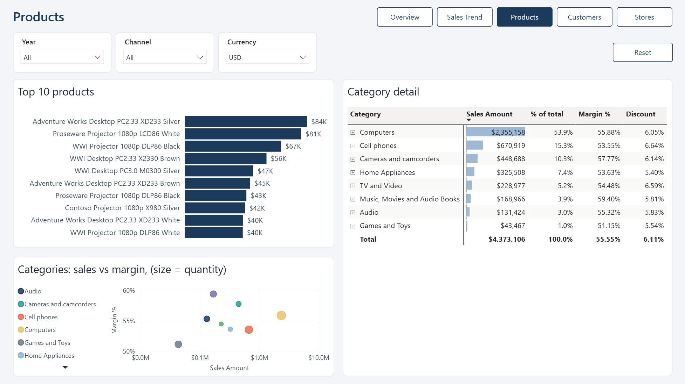
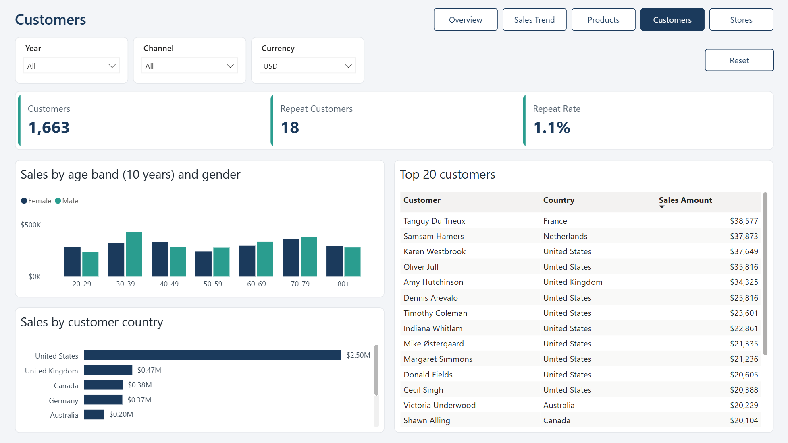
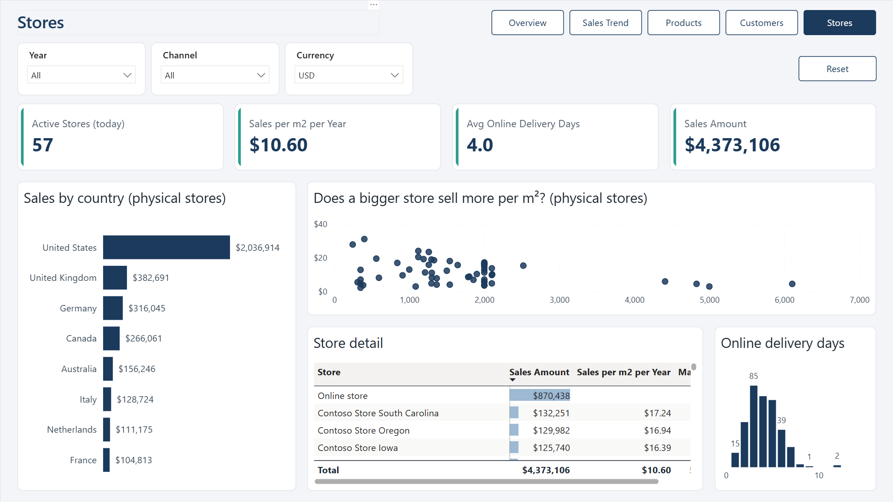

# Contoso Power BI Report

An interactive Power BI portfolio project for exploring retail sales, margins, customer behavior, product performance and store operations. The report combines five main pages with product drillthrough and a dedicated tooltip page.

## Project at a glance

- **7 report pages:** 5 main pages and 2 hidden supporting pages.
- **11 model tables**, **14 DAX measures**, **4 calculated columns** and **5 relationships**.
- **6 CSV sources**, transformed with Power Query; an additional currency lookup is derived from exchange-rate data.
- **3,996 stored sales rows**, with order dates from **21 May 2022 to 21 March 2026**.
- Dynamic metric and breakdown selectors, currency selection, time comparisons and navigation/reset controls are defined in the report.

## Report pages

| Page | What it explores |
|---|---|
| Overview | Sales, margin, orders, average order value and purchasing customers; channel and monthly views; selectable metrics and breakdowns. |
| Sales Trend | Monthly sales and year/month matrices with time calculation comparisons. |
| Products | Category and product comparisons using sales, quantity, margin and discount measures. |
| Customers | Purchasing and repeat customers, gender, age bands, geography and customer-level sales. |
| Stores | Physical-store and online views, active stores, delivery duration and sales per square meter per year. |
| Product Detail | Hidden drillthrough page filtered by ProductName, with product KPIs, monthly sales and geographic views. |
| Tooltip | Hidden supporting page with sales, margin and sales by year. |

## Data model

The core model follows a star structure: `Sales` is related to `Date`, `Customer`, `Product` and `Store`. All five relationships are many-to-one with single-direction filtering. The OrderDate relationship is active; the DeliveryDate relationship is inactive.

| Fact column | Dimension column | Status |
|---|---|---|
| Sales[OrderDate] | Date[Date] | Active |
| Sales[DeliveryDate] | Date[Date] | Inactive |
| Sales[CustomerKey] | Customer[CustomerKey] | Active |
| Sales[ProductKey] | Product[ProductKey] | Active |
| Sales[StoreKey] | Store[StoreKey] | Active |

Supporting tables are `CurrencyExchange`, `Currency`, `_Measures`, `Metric`, `Breakdown` and `Time Calc`. Currency conversion uses date/currency lookups in DAX. `Metric` and `Breakdown` are field parameter tables; `Time Calc` contains Actual, Last year, Change and Change % calculation items.

## Measures

| Group | Exact measure names |
|---|---|
| Sales | Sales Amount; Total Cost; Gross Profit; Margin %; Discount; Quantity; Orders; Avg Order Value |
| Customers | Customers; Repeat Customers; Repeat Rate |
| Stores | Sales per m2 per Year; Active Stores; Avg Online Delivery Days |

For example, Orders counts distinct OrderKey values, Avg Order Value divides sales by orders, and Margin % divides gross profit by sales. Measure expressions can be inspected directly in the Power BI file.

## Data preparation

Power Query reads `sales.csv`, `customer.csv`, `product.csv`, `store.csv`, `date.csv` and `currencyexchange.csv` through the `FolderPath` parameter. Transformations include data typing, customer name construction, blank-value handling, product price bands, store classification, delivery duration and sales-line amounts/costs. DAX adds customer age, age bands and a date-with-sales flag.

The source CSV files are not included in this repository. The PBIX contains the stored model data and transformation definitions.

## Report previews

### Overview



### Sales Trend



### Products



### Customers



### Stores



## Repository structure

```text
Contoso-Power-BI-Report/
├── README.md
├── Contoso.pbix
└── screenshots/
    ├── overview.png
    ├── sales-trend.png
    ├── products.png
    ├── customers.png
    └── stores.png
```

## Explore the report

View the screenshots above for a quick preview, or download [Contoso.pbix](Contoso.pbix) and open it in a compatible version of Power BI Desktop to explore the report and inspect its model, DAX measures and Power Query transformations.

Refreshing the data requires the six original CSV files and an updated `FolderPath` parameter pointing to their location. The CSV files are not distributed with this repository.
